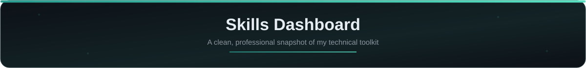
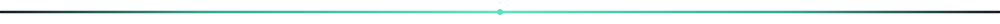

  

  

  
  

---

## About Me

Hi, I'm Hashem 👋

I'm a Software Developer and Data Scientist passionate about building modern web applications, developing intelligent solutions, and exploring the power of Artificial Intelligence and Machine Learning.

I enjoy solving complex problems, working with data, learning new technologies, and turning ideas into practical digital solutions.

---

## Skills Dashboard

  

  

<table>
  <tr>
    <td align="center" width="33%" valign="top">
      
        
      
        
      
      
      
    </td>
    <td align="center" width="33%" valign="top">
      
        
      
        
      
      
      
      
      
      
    </td>
    <td align="center" width="33%" valign="top">
      
        
      
        
      
      
      
      
    </td>
  </tr>
  <tr>
    <td align="center" width="33%" valign="top">
      
        
      
        
      
      
    </td>
    <td align="center" width="33%" valign="top">
      
        
      
        
      
      
      
      
      
      
    </td>
    <td align="center" width="33%" valign="top">
      
        
      
        
      
      
      
      
      
      
      
    </td>
  </tr>
</table>

  

## Featured Projects

> Selected independent projects from my academic and technical work. Public repository links are added only where available.

<table>
  <tr>
    <td width="50%" valign="top">
      <h3>Handwritten Algorithm Recognition & Python Translation</h3>
      
Built a pipeline to recognize handwritten algorithm content and translate it into Python-oriented output through preprocessing, feature extraction, and model training.

      

        
        
        
      

    </td>
    <td width="50%" valign="top">
      <h3>Tree Species Classification</h3>
      
Explored tree species classification using point clouds and multi-view learning, comparing classical ML, CNNs, transfer learning, PointNet, and DGCNN with accuracy, F1-score, and balanced accuracy.

      

        
        
        
      

    </td>
  </tr>
  <tr>
    <td width="50%" valign="top">
      <h3>Gradient Descent From Scratch</h3>
      
Implemented gradient descent from scratch and visualized convergence behavior to better understand optimization fundamentals.

      

        
        
        
      

    </td>
    <td width="50%" valign="top">
      <h3>Image Classification Pipeline</h3>
      
Developed an image classification workflow covering preprocessing, training, and evaluation to compare model performance.

      

        
        
        
      

    </td>
  </tr>
</table>

---

## GitHub Analytics

  
  

  

  

---

## Contribution Snake

  <picture>
    <source media="(prefers-color-scheme: dark)" srcset="https://raw.githubusercontent.com/nullHa10/nullHa10/output/github-snake-dark.svg" />
    <source media="(prefers-color-scheme: light)" srcset="https://raw.githubusercontent.com/nullHa10/nullHa10/output/github-snake.svg" />
    
  </picture>

> To activate the snake in your profile repository, copy `.github/workflows/snake.yml` from this draft into `nullHa10/nullHa10`, ensure Actions are enabled, and run the workflow once.

---

## Let's Connect

  
  &nbsp;&nbsp;
  

